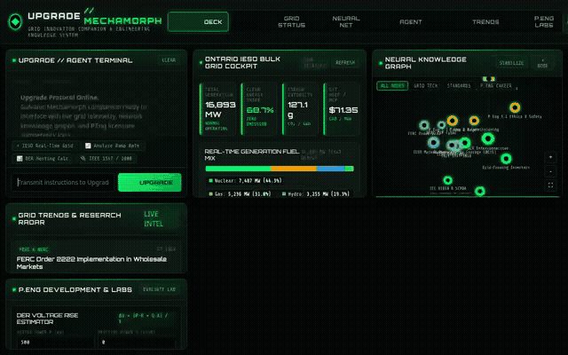

# Upgrade // Grid Innovation Companion

An agentic electrical power engineering assistant inspired by Ben 10's *Upgrade* (Galvanic Mechamorph). Designed for utility engineers, power systems practitioners, and engineers-in-training (EITs) navigating grid modernization, regulatory standards (IEEE 1547-2018, CSA C235), and career milestones toward professional licensure (P.Eng).



---

## What the Agent Does

The agent operates as a specialized power systems co-pilot equipped with domain-specific engineering tools, Google Cloud services, and a Galvanic Mechamorph-themed cyberdeck interface.

### Implemented Capabilities & Tools

1. **Live Bulk Electricity System Telemetry (`get_ontario_grid_status`)**
   - Ingests and parses real-time generator capability and output data directly from the official Ontario Independent Electricity System Operator (IESO) public telemetry feeds.
   - Computes total generation (MW), non-emitting clean generation percentage, grid carbon intensity (g CO₂/kWh), and estimated Hourly Ontario Energy Price (HOEP / MCP).
   - Breaks down active generation across Nuclear, Natural Gas, Hydroelectric, Wind, Solar, and Biofuel.

2. **Emerging Grid Technology Catalog (`list_grid_technologies`, `get_grid_technology`, `add_grid_technology`)**
   - Queries and persists records in a **Google Cloud Firestore** collection (`grid_technologies`).
   - Tracks emerging utility technologies—including Grid-Forming (GFM) Inverters, Battery Energy Storage Systems (BESS), Virtual Power Plants (VPP), Dynamic Line Rating (DLR), and Feeder Automation—along with Technology Readiness Levels (TRL 1–9), primary utility use cases, and applicable standards.

3. **Distribution Feeder Hosting Capacity Analysis (`calculate_feeder_hosting_capacity`)**
   - Evaluates point of common coupling (PCC) voltage rise ($\Delta V$) and reverse power flow for proposed Distributed Energy Resource (DER) solar and battery installations using classical feeder impedance modeling:
     $$\Delta V \approx \frac{P \cdot R + Q \cdot X}{V_{\text{nominal}}}$$
   - Benchmarks compliance against **CSA C235** voltage variation limits and recommends smart inverter autonomous functions (Volt-VAR, Volt-Watt) per **IEEE 1547-2018**.

4. **Renewable Resource Telemetry (`get_solar_and_wind_resource`)**
   - Queries real-time solar irradiance (Direct Normal Irradiance, global horizontal radiation), wind speed, and ambient temperature via Open-Meteo for estimating renewable generation and conductor Dynamic Line Rating.

5. **Multimodal Technical Illustrations (`generate_grid_technology_image`)**
   - Uses the **`gemini-3.1-flash-lite-image`** model on Vertex AI (global region) to generate visual engineering sketches, single-line diagrams, and substation equipment layouts.
   - Automatically saves the generated image as an ADK session artifact (`tool_context.save_artifact`).
   - Uploads the raw image bytes to a public **Google Cloud Storage** bucket and returns a public HTTPS link for display.

6. **P.Eng Competency & Career Tracker (`log_career_competency`, `list_career_competencies`)**
   - Records engineering project experience and core competencies into a **Google Cloud Firestore** collection (`career_competencies`).
   - Maps milestones to the 34 indicators of the Professional Engineers Ontario (PEO) Competency-Based Assessment (CBA) framework.

7. **Structured Agent-to-User Interface (A2UI v0.8)**
   - Formats complex operational replies into structured UI components (`Card`, `Column`, `Row`, `Text`, `Image`) via `A2uiSchemaManager` and an `after_model_callback`.

8. **Long-Term Memory Bank**
   - Connected to **Vertex AI Agent Engine Memory Bank** (`VertexAiMemoryBankService`) to recall engineer project context, past studies, and mastered topics across conversations via `PreloadMemoryTool` and `generate_memories_callback`.

---

## Roadmap & Planned Features

The following items from the initial concept brief are planned for future iterations:
- **Interactive Code Sandbox**: Direct Python sandbox execution for processing raw CSV substation feeder interval data and load duration curves *(planned, not yet implemented)*.
- **Power Systems Drill Generator**: Interactive per-unit calculation and symmetrical component quiz engine for P.Eng examination prep *(planned, not yet implemented)*.
- **Daily Utility Task Planner**: Automated morning briefing and evening debrief workflow *(planned, not yet implemented)*.

---

## Architecture & Google Cloud Services

```
┌────────────────────────────────────────────────────────────────────────┐
│               Frontend Cyberdeck (FastAPI Proxy + HTML5)               │
│    Chat Terminal  │  Obsidian Neural Graph  │  Live Bulk Grid Cockpit  │
└──────────────────────────────────┬─────────────────────────────────────┘
                                   │ (A2A Protocol / HTTP)
                                   ▼
┌────────────────────────────────────────────────────────────────────────┐
│               Google Cloud Agent Platform / Agent Runtime              │
│                     (ADK Root Agent + A2UI Callback)                   │
└───────┬──────────────────────────┬──────────────────────────────┬──────┘
        │                          │                              │
        ▼                          ▼                              ▼
┌──────────────┐           ┌──────────────┐               ┌──────────────┐
│  Vertex AI   │           │ Google Cloud │               │ Google Cloud │
│ Memory Bank  │           │  Firestore   │               │   Storage    │
│ (Sessions &  │           │ (Techs & PEO │               │ (Public GCS  │
│  Context)    │           │ Competencies)│               │ Image Store) │
└──────────────┘           └──────────────┘               └──────────────┘
```

- **Runtime**: Vertex AI Agent Engine (Agent Runtime)
- **Model**: `gemini-3.8-flash` (publisher model, global)
- **Image Generation**: `gemini-3.1-flash-lite-image` (Vertex AI, global)
- **Database**: Cloud Firestore (Native mode)
- **Object Storage**: Google Cloud Storage (public diagram hosting)
- **Memory Service**: Vertex AI Agent Engine Memory Bank
- **Protocol**: Agent-to-Agent (A2A) protocol via `a2a-sdk`

---

## Project Structure

```
.
├── app/
│   ├── __init__.py
│   ├── agent.py               # Core ADK agent definition, tools, and callbacks
│   └── a2ui_utils.py          # A2UI schema manager and callback utilities
├── frontend/
│   ├── Dockerfile             # Container definition for Cloud Run deployment
│   ├── requirements.txt       # Frontend dependencies (FastAPI, a2a-sdk, etc.)
│   ├── main.py                # FastAPI proxy connecting browser to deployed agent
│   └── static/
│       └── index.html         # Ben 10 Upgrade themed UI (Chat, Canvas Graph, Grid Cockpit)
├── agents-cli-manifest.yaml   # Deployment manifest targeting Agent Runtime
├── demo.gif                   # Looping recording of the agent in action
├── requirements.txt           # Agent environment dependencies
└── README.md
```

---

## Local Setup & Running Instructions

### Prerequisites
- Python 3.11+
- Google Cloud SDK (`gcloud`) authenticated with Application Default Credentials:
  ```bash
  gcloud auth login
  gcloud auth application-default login
  gcloud config set project <YOUR_GCP_PROJECT_ID>
  ```

### 1. Running the Agent with ADK Web Playground

To run the agent locally within the ADK development playground:

```bash
# Install dependencies
pip install -r requirements.txt

# Launch local ADK playground pointing to your Agent Engine Memory Bank
uv run adk web . --port 8000 --reload_agents --memory_service_uri=agentengine://<AGENT_ENGINE_ID>
```

### 2. Running the Custom Upgrade Frontend Locally

To run the custom cyberdeck UI (FastAPI proxy + Mechamorph HUD):

```bash
cd frontend

# Set environment configuration
export AGENT_ENGINE_RESOURCE_NAME="projects/<PROJECT_NUMBER>/locations/<REGION>/reasoningEngines/<ENGINE_ID>"
export AGENT_DIRECTORY="app"
export PORT=8080

# Install frontend dependencies and start server
pip install -r requirements.txt
python main.py
```

### 3. Deploying the Frontend to Cloud Run

To ship the frontend container to Cloud Run:

```bash
cd frontend

gcloud run deploy frontend \
  --source . \
  --region us-east1 \
  --allow-unauthenticated \
  --service-account <COMPUTE_OR_CUSTOM_SERVICE_ACCOUNT> \
  --set-env-vars "AGENT_ENGINE_RESOURCE_NAME=projects/<PROJECT_NUMBER>/locations/<REGION>/reasoningEngines/<ENGINE_ID>,AGENT_DIRECTORY=app"

# Grant the Cloud Run service account permission to invoke the Agent Engine
gcloud projects add-iam-policy-binding <YOUR_GCP_PROJECT_ID> \
  --member="serviceAccount:<COMPUTE_OR_CUSTOM_SERVICE_ACCOUNT>" \
  --role="roles/aiplatform.user"
```
